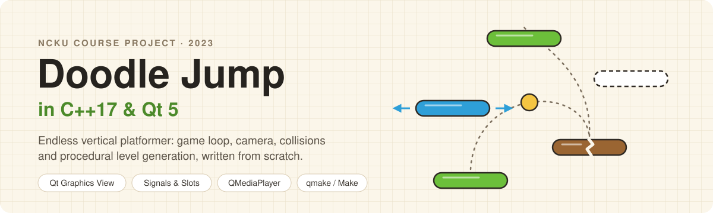
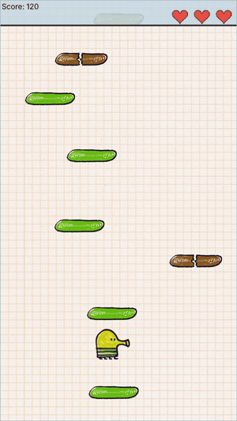
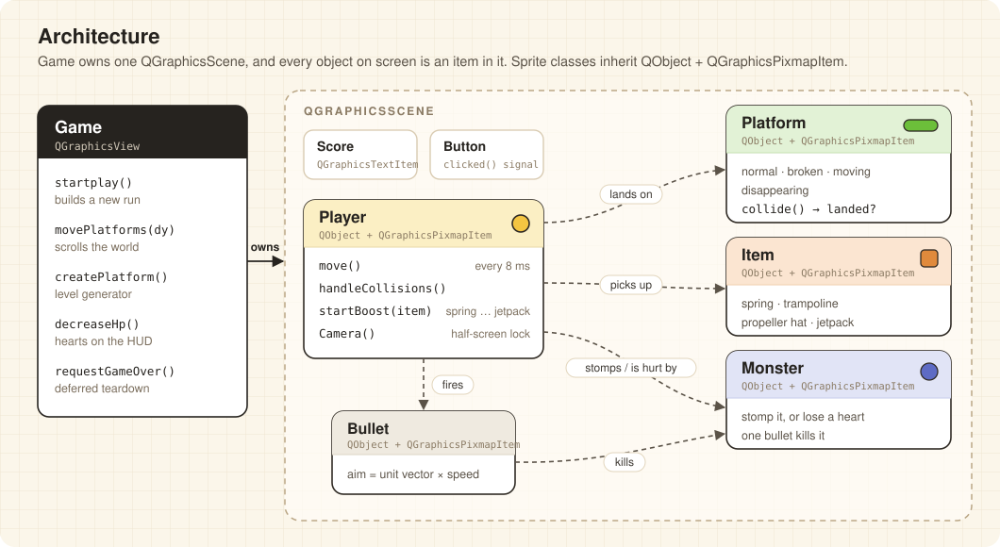
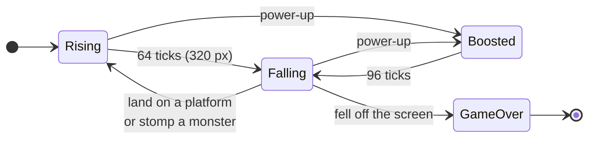
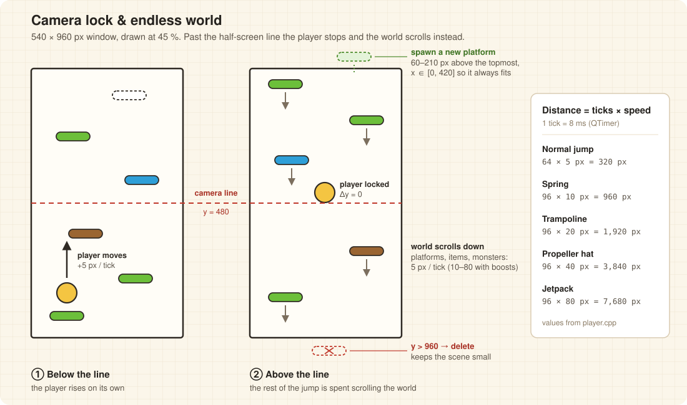
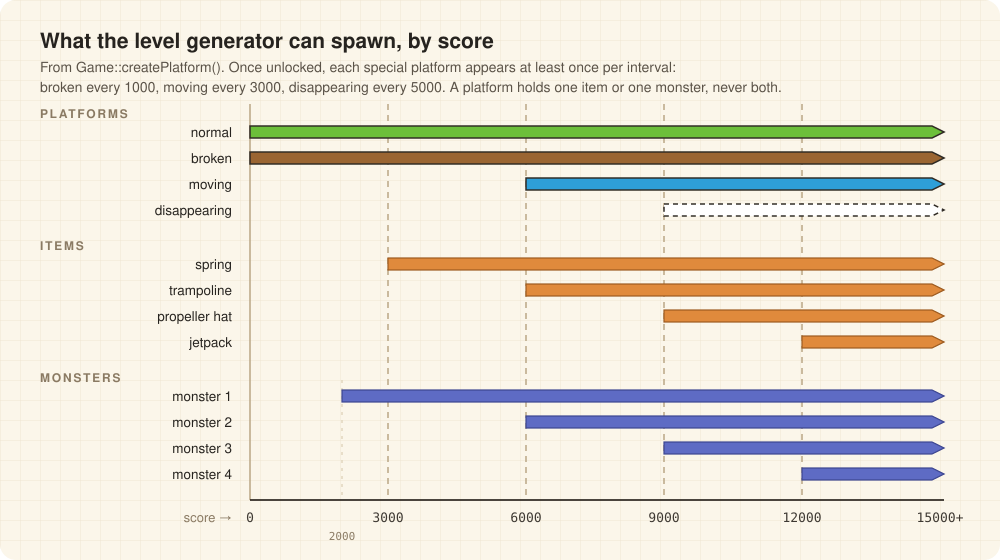

<p align="center">
  
</p>

<p align="center">
  
  
  
  
</p>

A remake of the mobile game *Doodle Jump*, built from scratch in **C++17 on Qt 5's Graphics View framework** as a course project for *Introduction to Computer Science* (計算機概論), taught by Prof. Yean-Ru Chen (陳瑩如) at National Cheng Kung University (NCKU), spring 2023.

There is no game engine underneath. The update loop, jump physics, camera, collision handling, procedural level generator, sprite animation and sound are all hand-written, in about 1,300 lines of C++ across 8 classes, plus a headless test for the level generator.

<p align="center">
  
</p>

## Highlights

- **Engine-free game loop.** Every on-screen object is a `QGraphicsPixmapItem` in a single `QGraphicsScene`. The player's physics runs on an 8 ms `QTimer` tick, platforms and bullets on their own timers, all connected through Qt signals and slots.
- **Jump distances by construction.** Motion is constant-speed, so every jump is simply *ticks × pixels per tick*: 64 × 5 = 320 px for a normal jump, and 96 ticks at 10 / 20 / 40 / 80 px for the spring, trampoline, propeller hat and jetpack (the spec's 960 / 1,920 / 3,840 / 7,680 px).
- **Camera lock.** Once the player crosses the half-screen line, its position is frozen and the rest of the motion is applied to the world instead, so even at jetpack speed it never leaves the screen.
- **Level generator that keeps the spec's promises.** The spec asks for at least one broken platform every 1000 px, a moving one every 3000 px after 6000 and a disappearing one every 5000 px after 9000. The generator remembers which interval each type last appeared in and forces it before an interval runs out. Broken platforms are decoys you fall through, so gaps are measured from the last platform you can actually stand on: 60 to 210 px, always inside the 320 px jump.
- **Tested headless.** [`tests/spawn_rules_test.cpp`](tests/spawn_rules_test.cpp) drives the real generator for 50 random seeds × 60,000 px and checks spacing, reachability, the interval guarantees and the item and monster caps.
- **Direction-aware collisions.** Platforms are one-way: a landing only counts when a falling doodle's feet come down onto the top edge. Landing on a monster's head is a stomp; bumping into its side or bottom costs a heart; a flying doodle can't be hurt. Collisions are dispatched by type with `dynamic_cast` over `collidingItems()`.
- **Safe object lifetimes.** A run can end from deep inside a collision callback, so the teardown is deferred to the next event-loop turn with `QTimer::singleShot(0, …)`, and objects removed mid-update are released with `deleteLater()`. Everything that scrolls off screen is freed, so memory stays flat however long you play.
- **Mouse-aimed shooting.** Space fires toward the cursor, mapped from global to viewport to scene coordinates; the aim vector is normalised and scaled to a fixed bullet speed.
- **Animation and audio.** Facing and shooting poses, a 4-frame propeller-hat loop, a 10-frame jetpack loop, cracking platforms and bouncing trampolines, plus sound effects for jumping, shooting, breaking platforms and stomping, through `QMediaPlayer`.

## Gameplay

| Input | Action |
| --- | --- |
| Click **Play** | Start a run (and play again after a game over) |
| <kbd>←</kbd> / <kbd>→</kbd> | Move left / right (wraps around the screen edges) |
| <kbd>Space</kbd> | Shoot toward the mouse cursor |

- The doodle bounces automatically whenever it lands. Your score is the highest point you reach, in pixels.
- **4 platform types:** normal; broken (cracks and drops away, and you fall straight through); moving (patrols left and right); disappearing (good for one bounce, then fades).
- **4 power-ups** unlock as you climb: spring (from 3000, jumps 960 px), trampoline (from 6000, 1,920 px), propeller hat (from 9000, flies 3,840 px) and jetpack (from 12000, flies 7,680 px). At most two are on screen at a time, and you can't be hurt while flying.
- **4 monsters** from 2000: stomp them, shoot them, or lose one of your 3 hearts by running into them.
- The run ends when you fall off the bottom of the screen or lose your last heart.

## How it works

### Architecture

`Game` is the `QGraphicsView`. It owns the scene, switches between the start, play and game-over screens, scrolls the world and runs the level generator. Every sprite type is its own class that inherits from both `QObject` (for signals, slots and timers) and `QGraphicsPixmapItem` (for drawing and collision shapes).

<p align="center">
  
</p>

### Jump and camera

The player is a small state machine driven by a tick counter. Rising always ignores platforms; only a falling player can land. Springs and trampolines fire when landed on, while the propeller hat and jetpack fire on any touch. Losing the last heart ends the run from any state.



While the player is below the middle of the screen it moves itself. Above the middle, `Game::movePlatforms()` moves everything else down by the same amount, frees whatever leaves the bottom and generates new platforms above the top edge.

<p align="center">
  
</p>

### Level generation

Each new platform goes 60 to 210 px above the last platform the player can stand on, at a random x that keeps it on screen. Its type, and whether it carries an item or a monster, comes from a score-tiered table:

<p align="center">
  
</p>

- Most platforms are normal. Each special type has a small chance per platform and is forced when its interval is about to end without one.
- A broken platform is never followed by another one, and the next real step is placed above it, so a decoy can't make a gap impossible.
- Items and monsters only appear on normal platforms, never on the same one, and at most two of each exist at a time.

## Build and run

**Requirements:** Qt 5 with the Widgets and Multimedia modules, and a C++17 compiler. Originally developed with Qt 5.9.4 and g++ under Cygwin on Windows; also builds with Qt 5.15 on Linux. Qt 6 would need a small port, since the code uses `QMediaPlayer::setMedia()`, which Qt 6 removed.

```bash
git clone https://github.com/12yuuuu/doodle.git
cd doodle
mkdir build && cd build
qmake ../Project_1.pro   # generates a Makefile for your machine
make
```

**Assets.** The sprites and sounds were provided with the assignment (based on the original game by Lima Sky), so they are not redistributed here. The game loads them from `./dataset/` relative to the working directory, so put that folder next to where you launch the binary:

```text
build/
├── Project_1          # Project_1.exe on Windows, Project_1.app on macOS
└── dataset/
    ├── images/        # sprites, plus doodleH/ and doodleJ/ animation frames
    └── sounds/        # jump.wav, shoot.wav, break.wav, jumponmonster.wav
```

<details>
<summary>Every asset file the code loads</summary>

```text
dataset/images/
  background.png  bullet.png
  doodleL.png  doodleUL.png  doodleUR.png  doodleS.png
  doodleH/doodleH1.png ... doodleH4.png         # propeller-hat frames
  doodleJ/doodleJ1.png ... doodleJ10.png        # jetpack frames
  stair-basic.png  stair-blue.png  stair-disapear.png
  stair-broken1.png ... stair-broken4.png
  item-spring1.png  item-spring2.png
  item-trampoline1.png ... item-trampoline3.png
  item-propeller-hat.png  item-jetpack.png
  monster1.png ... monster4.png
  welcome.png  play_button.png  end.png  toolbar.png  hp.png   # made for this project, not in the provided set
dataset/sounds/
  jump.wav  break.wav
  shoot.wav  jumponmonster.wav                  # converted from the provided .mp3 files
```

</details>

Then run it from `build/`: `./Project_1` (Windows: `Project_1.exe`, macOS: `./Project_1.app/Contents/MacOS/Project_1`).

### Tests

The generator test needs neither assets nor a display:

```bash
mkdir build-tests && cd build-tests
qmake ../tests/tests.pro && make
QT_QPA_PLATFORM=offscreen ./spawn_rules_test
# 50 seeds x 60000 px: all spawn rules hold
```

## Project structure

| File | Responsibility |
| --- | --- |
| `main.cpp` | Creates the `QApplication` and the global `Game`, seeds the random generator |
| `game.h/.cpp` | `QGraphicsView`: screens (start / play / game over), HUD and hearts, world scrolling, level generator |
| `player.h/.cpp` | Input, jump and boost state machine, camera lock, collision handling, shooting, score |
| `platform.h/.cpp` | Four platform types: one-way landing, break-and-fall, horizontal patrol, fade-out |
| `item.h/.cpp` | Spring, trampoline, propeller hat and jetpack; each switches the player into a boost state |
| `monster.h/.cpp` | Four monster types: stomp versus hit resolution; a stomped monster falls away |
| `bullet.h/.cpp` | Projectile moving along a normalised aim vector; one shot, one kill |
| `score.h/.cpp` | Score text item on the HUD |
| `button.h/.cpp` | Clickable pixmap that emits a custom `clicked()` signal |
| `tests/` | Headless test of the level generator's spawn rules |
| `Project_1.pro` | qmake project: Qt core / gui / widgets / multimedia, C++17 |

## Tech stack and skills

| Area | Used |
| --- | --- |
| **Language** | C++17 |
| **Rendering and UI** | Qt 5 Widgets, Graphics View framework (`QGraphicsView`, `QGraphicsScene`, `QGraphicsPixmapItem`) |
| **Audio** | Qt Multimedia (`QMediaPlayer`) |
| **Build and test** | qmake, GNU Make, g++; headless Qt test with the offscreen platform plugin |

- **Object-oriented C++:** a class hierarchy on top of Qt, multiple inheritance (`QObject` + `QGraphicsPixmapItem`), runtime type dispatch.
- **Event-driven, real-time programming:** signals and slots, timer-driven updates, keyboard and mouse input, object lifetimes inside callbacks.
- **Game systems:** collision resolution, camera and scrolling, constrained procedural generation, sprite animation, audio.
- **Spec to code:** the course spec's screen and sprite sizes, jump distances, unlock scores and spawn guarantees are encoded as constants and tick counts, and the guarantees are tested.

## Known limitations

- Motion is tied to timer ticks rather than elapsed time, so the game slows down if the event loop is starved.
- Jumps are constant-speed, as the spec asks; a gravity-based jump was an optional bonus that isn't implemented.
- Each sound effect has a single `QMediaPlayer`, so rapid repeats of the same effect cut each other off.
- Qt 5 only; Qt 6 replaced the `QMediaPlayer` API used here.

## Authors

- Ana Liu ([@12yuuuu](https://github.com/12yuuuu))
- Donna Hsu

## Credits

- *Doodle Jump* and its original art belong to Lima Sky. This is a non-commercial, educational remake.
